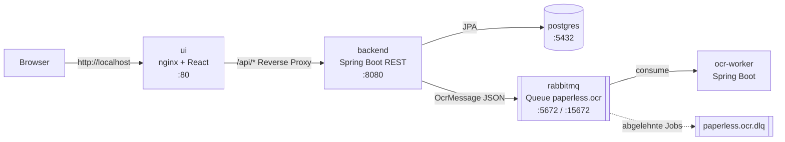

# Paperless (SWEN3)

[](https://github.com/OishikRoyVienna/Swen3/actions/workflows/ci.yml)

Paperless ist ein **Dokumentenmanagementsystem**: Dokumente werden digital abgelegt, verwaltet und kommentiert.
Jedes neue Dokument bekommt automatisch einen **OCR-Auftrag**, den ein eigener Hintergrunddienst verarbeitet.
Die eigentliche Texterkennung folgt in einem späteren Sprint; im Moment nimmt der Worker die Aufträge entgegen und protokolliert sie.

Semesterprojekt der Lehrveranstaltung SWEN3 an der FH Technikum Wien.

---

## Schnellstart

**Voraussetzung:** [Docker Desktop](https://www.docker.com/products/docker-desktop/) läuft.

```bash
git clone https://github.com/OishikRoyVienna/Swen3.git
cd Swen3
docker compose up -d --build
```

Der erste Build dauert einige Minuten. Danach laufen fünf Container (`docker compose ps`):

| Was | Adresse |
|---|---|
| **Web-UI** | http://localhost |
| REST-API direkt | http://localhost:8080/api/documents |
| RabbitMQ-Verwaltung | http://localhost:15672 (Login `paperless` / `paperless`) |
| PostgreSQL | `localhost:5432`, Datenbank/Benutzer/Passwort `paperless` |

**Ausprobieren:** In der UI ein Dokument anlegen und dabei die Logs mitlesen:

```bash
docker compose logs -f --tail=0 backend ocr-worker
```

Man sieht, wie das Backend das Dokument speichert und einen OCR-Auftrag in die Queue legt, und wie der Worker ihn kurz danach abholt.

**Stoppen:** `docker compose down` (Daten bleiben erhalten) · **Alles zurücksetzen:** `docker compose down -v` (löscht die Datenbank).

---

## Architektur



| Container | Aufgabe | Code |
|---|---|---|
| `ui` | nginx liefert die React-App aus und leitet `/api/*` an das Backend weiter | [`ui-react/`](ui-react) |
| `backend` | REST-API, Geschäftslogik, Datenbankzugriff, sendet OCR-Aufträge | [`src/`](src) |
| `postgres` | speichert Dokumente und Kommentare (Volume `postgres_data`) | – |
| `rabbitmq` | Message Broker zwischen Backend und Worker | – |
| `ocr-worker` | verarbeitet OCR-Aufträge aus der Queue (OCR selbst noch leer) und prüft regelmäßig die Dead-Letter-Queue | [`ocr-worker/`](ocr-worker) |

### Was passiert beim Anlegen eines Dokuments?

1. Die React-UI prüft die Eingaben und schickt `POST /api/documents` an nginx.
2. nginx leitet den Request an `backend:8080` weiter.
3. Der Controller validiert das JSON (`@Valid`), der Service speichert das Dokument in PostgreSQL.
4. Der Service schickt eine `OcrMessage` (ID, Dateiname, Typ, Datum) an die Queue `paperless.ocr`.
5. Ist RabbitMQ nicht erreichbar, wird das Speichern zurückgerollt und die API antwortet mit **503**. So entsteht kein Dokument ohne OCR-Auftrag.
6. Der OCR-Worker empfängt die Nachricht und verarbeitet sie. Ungültige Aufträge landen in der Dead-Letter-Queue `paperless.ocr.dlq`.

### Tech-Stack

| Bereich | Technologie |
|---|---|
| Backend & Worker | Java 25, Spring Boot 4.1 (Web MVC, Data JPA, Validation, AMQP) |
| Datenbank | PostgreSQL 17 (Tests: H2 in-memory) |
| Messaging | RabbitMQ 4 |
| Frontend | React 19, React Router 7, Vite |
| Webserver | nginx 1.27 |
| Tests | JUnit 5, Mockito, MockMvc |
| Build & Betrieb | Maven Wrapper, npm, Docker Compose, GitHub Actions |

---

## Projektstruktur

```
Swen3/
├── docker-compose.yml          alle fünf Dienste
├── Dockerfile                  Backend-Image (Maven-Build → JRE)
├── pom.xml                     Backend-Abhängigkeiten
├── src/main/java/at/fhtw/swen3/
│   ├── controller/             REST-Endpunkte (HTTP ↔ Service)
│   ├── dto/                    *Request = Eingabe, *Dto = Ausgabe der API
│   ├── mapper/                 Entity ↔ DTO
│   ├── service/                Interfaces + *Impl mit der Geschäftslogik
│   ├── repository/             Spring-Data-Repositories
│   ├── entity/                 JPA-Entities Document, Comment
│   ├── messaging/              OcrMessage, OcrMessagePublisher (Interface), OcrMessageProducer (RabbitMQ)
│   ├── config/                 RabbitMQ-Queues und JSON-Converter
│   └── exception/              Exceptions pro Schicht, GlobalExceptionHandler
├── src/main/resources/application.properties
├── src/test/                   Unit- und Web-Tests
├── ocr-worker/                 eigener Dienst, eigenes Maven-Projekt
│   └── src/main/java/at/fhtw/swen3/ocr/   config/ messaging/ service/ exception/
├── ui-react/                   Frontend
│   ├── Dockerfile, nginx.conf
│   └── src/  App.jsx (Routen), api.js (REST-Client), validation.js, pages/, components/
├── docs/                       zusätzliche Dokumentation (z. B. Sprint 3)
└── .github/workflows/ci.yml    CI-Pipeline
```

---

## REST-API

| Methode | Pfad | Beschreibung | Erfolg |
|---|---|---|---|
| GET | `/api/documents` | alle Dokumente | 200 |
| POST | `/api/documents` | Dokument anlegen und OCR-Auftrag senden | 201 |
| GET | `/api/documents/{id}` | ein Dokument | 200 |
| PUT | `/api/documents/{id}` | Dokument ändern | 200 |
| DELETE | `/api/documents/{id}` | Dokument samt Kommentaren löschen | 204 |
| GET | `/api/documents/{id}/comments` | Kommentare eines Dokuments | 200 |
| POST | `/api/documents/{id}/comments` | Kommentar hinzufügen | 201 |
| DELETE | `/api/documents/{id}/comments/{commentId}` | Kommentar löschen | 204 |

Beispiel:

```bash
curl -X POST http://localhost:8080/api/documents \
  -H "Content-Type: application/json" \
  -d '{"title":"Rechnung Oktober","filename":"rechnung-10.pdf","contentType":"application/pdf"}'
```

Fehler kommen einheitlich als JSON zurück: `{ "timestamp", "status", "error", "message" }`.

| Status | Bedeutung |
|---|---|
| 400 | ungültige Eingabe, kaputtes JSON oder ID ist keine Zahl |
| 404 | Dokument oder Kommentar existiert nicht |
| 500 | Datenbankfehler (Details nur im Log) |
| 503 | OCR-Auftrag konnte nicht in die Queue gelegt werden |

---

## Design-Entscheidungen

| Entscheidung | Begründung |
|---|---|
| **Schichtenarchitektur** Controller → Service → Repository | klare Verantwortlichkeiten, jede Schicht einzeln testbar |
| **Services hinter Interfaces** (`DocumentService`, `OcrMessagePublisher`) | lose Kopplung: Der Controller kennt nur das Interface, der Service weiß nicht, dass RabbitMQ dahintersteht |
| **DTOs statt Entities in der API** | API bleibt stabil, wenn sich die DB ändert; Validierung hängt am Request |
| **Exceptions pro Schicht** (`ServiceException`, `RepositoryException`, `MessageQueueException`) | man sieht sofort, wo ein Fehler entstand; zentral im `GlobalExceptionHandler` auf HTTP-Status abgebildet |
| **OCR als eigener Dienst über eine Queue** | OCR ist langsam; der Upload wartet nicht darauf, der Worker kann unabhängig neu starten und skaliert werden |
| **Dead-Letter-Queue** | kaputte Aufträge gehen nicht verloren und werden nicht endlos neu zugestellt |
| **Geplanter DLQ-Check** (`DeadLetterQueueMonitor`, `@Scheduled`) | fehlgeschlagene Aufträge fallen auf: Der Worker prüft jede Minute die Queue und schreibt eine Warnung ins Log |
| **nginx als Reverse Proxy** | UI und API haben denselben Origin, dadurch keine CORS-Konfiguration nötig |
| **Validierung im Frontend und im Backend** | Frontend für schnelles Feedback, Backend zur Sicherheit, weil man die UI umgehen kann |
| **Konfiguration über Umgebungsvariablen** | `application.properties` enthält Werte für den lokalen Start, docker-compose überschreibt sie (z. B. `SPRING_DATASOURCE_URL`) |

---

## Entwicklung ohne Docker-Build

Praktisch, wenn man am Code arbeitet und nicht bei jeder Änderung neu bauen will.

**Backend aus der IDE oder per Maven** (Datenbank und RabbitMQ laufen in Docker):

```bash
docker compose up -d postgres rabbitmq
./mvnw spring-boot:run
```

**OCR-Worker:**

```bash
cd ocr-worker
./mvnw spring-boot:run
```

In IntelliJ den Worker einmal über `ocr-worker/pom.xml` → *Add as Maven Project* einbinden.

**Frontend mit Hot Reload** (Node.js nötig):

```bash
cd ui-react
npm install
npm run dev        # http://localhost:5173, /api wird an localhost:8080 weitergeleitet
```

---

## Tests und Qualität

```bash
./mvnw test                        # Backend
cd ocr-worker && ./mvnw test       # Worker
cd ui-react && npm run lint        # Frontend
```

**Teststrategie**

| Art | Was wird getestet | Werkzeug |
|---|---|---|
| Unit-Tests | Services, Producer, Worker-Logik inkl. Fehlerfällen | Mockito, Abhängigkeiten werden gemockt |
| Web-Tests | Controller, Validierung, Fehler-Mapping (400/404/500/503) | `@WebMvcTest` + MockMvc |
| Context-Tests | Anwendung startet vollständig | `@SpringBootTest` mit H2 |

Die Tests brauchen weder PostgreSQL noch RabbitMQ.

**CI:** Bei jedem Push und Pull Request baut und testet [GitHub Actions](.github/workflows/ci.yml) Backend, Worker und Frontend und baut danach alle Docker-Images.

**Logging:** SLF4J in allen Schichten (Controller, Service, Persistenz, Messaging, Worker), Fehler im Frontend in der Browser-Konsole. Mehr Details: `LOGGING_LEVEL_AT_FHTW_SWEN3=DEBUG` beim Backend setzen.

---

## Arbeitsweise

- **Branches:** pro Sprint/Feature ein Branch `feature/...`, Merge nach `main` per Pull Request.
- **Issues:** Sprints und Aufgaben werden als [GitHub Issues](https://github.com/OishikRoyVienna/Swen3/issues) verwaltet.
- Ein Pull Request wird nur gemergt, wenn die CI grün ist.

| Sprint | Inhalt |
|---|---|
| 1 | Projekt-Setup, REST-API, DAL mit Mapping, Unit-Tests, docker-compose |
| 2 | Web-UI (React) mit nginx, Validierung, Dashboard und Detailseite |
| 3 | RabbitMQ, OCR-Worker, Exceptions pro Schicht, Logging ([Details](docs/Sprint3-RabbitMQ-OCR-Worker.pdf)) |

---

## Lessons Learned

- **Konfiguration doppelt halten ist fehleranfällig:** Backend und Worker deklarieren die Queues mit identischen Argumenten. Weicht eine Seite ab, lehnt RabbitMQ die Deklaration ab (`PRECONDITION_FAILED`).
- **Zeilenenden zählen:** Unter Windows ausgecheckte Skripte mit CRLF brechen im Linux-Container. `.gitattributes` erzwingt deshalb LF für `mvnw`.
- **Abhängigkeiten nicht voraussetzen:** Dem Worker fehlte ohne Web-Starter die Jackson-Bibliothek. Ein einfacher Context-Test hätte das sofort gezeigt und ist jetzt Teil der Tests.
- **Healthchecks statt Startreihenfolge:** `depends_on` allein reicht nicht; erst `condition: service_healthy` stellt sicher, dass Datenbank und Broker bereit sind.

---

## Bekannte Einschränkungen und nächste Schritte

- Es gibt noch keinen echten **Datei-Upload**, gespeichert werden nur die Metadaten → Datei-Upload mit Object Storage (z. B. MinIO).
- Der OCR-Worker ist **noch leer** → Texterkennung (z. B. Tesseract) und Rückmeldung an das Backend.
- Die Nachricht wird innerhalb der Datenbank-Transaktion gesendet → später Transactional-Outbox-Pattern.
- Keine Authentifizierung, keine Volltextsuche.

---

## Häufige Probleme

| Problem | Lösung |
|---|---|
| `port is already allocated` | Ein anderes Programm nutzt den Port (80, 8080, 5432, 5672). Programm beenden oder das Port-Mapping in `docker-compose.yml` ändern, z. B. `"8081:8080"`. |
| UI zeigt kurz „502 Bad Gateway“ | Das Backend startet noch, 10–20 Sekunden warten. |
| Code geändert, aber alte Version läuft | `docker compose up -d --build` |
| Upload liefert 503 | RabbitMQ läuft nicht: `docker compose ps`, ggf. `docker compose up -d rabbitmq` |
